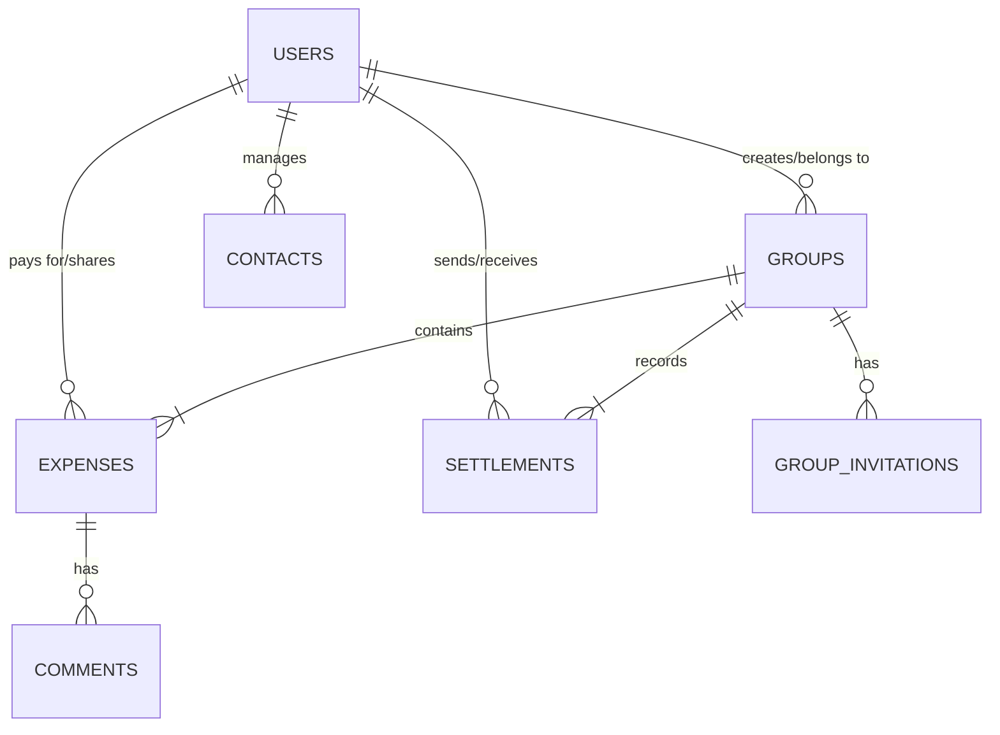
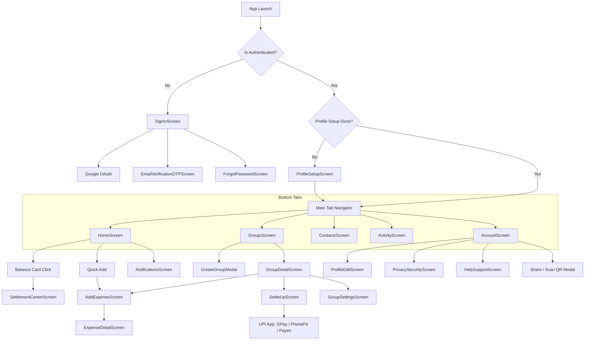

# SplitMate — Codebase Architecture & System Context
**Product:** SplitMate  
**Brand:** Fyndra Labs  
**Tagline:** Spend, Split, Settle.  
**Target Platform:** Android (Expo React Native with TypeScript)  
**Dominant Design System:** Sky Blue (`#0284C7`, `#38BDF8`, `#0369A1`, `#F0F9FF`, `#E0F2FE`)

---

## 1. Full Directory Tree

```
SplitMate/
├── .expo/                       # Expo local cache and metadata
├── .firebaserc                  # Firebase project aliases (default: splitmate-d2d66)
├── .gitignore                   # Git ignore specifications
├── App.tsx                      # Root application entry with Providers & Error Boundary
├── index.ts                     # Expo registerRootComponent bootstrap
├── app.json                     # Expo SDK 52 application configuration & Android permissions
├── package.json                 # Node dependencies, scripts, and package version specifications
├── tsconfig.json                # TypeScript compiler configuration (ESNext, React JSX)
├── firebase.json                # Firebase Cloud Functions & Firestore configurations
├── firestore.rules              # Cloud Firestore security rules & privilege models
├── storage.rules                # Cloud Storage security rules for receipts and profile photos
├── google-services.json         # Firebase Android client configuration
├── eas.json                     # Expo Application Services build & submit profiles
│
├── android/                     # Bare Android prebuild native project
│   ├── build.gradle             # Top-level Gradle buildscript (Kotlin 1.9.25, AGP, GMS 4.4.1)
│   ├── settings.gradle          # Gradle module inclusion & React Native autolinking
│   ├── gradle.properties        # JVM memory, AndroidX, Hermes, Proguard & packaging options
│   ├── keystore.properties      # Signing key definitions for release APK / AAB
│   ├── sentry.properties        # Sentry crash reporting integration tokens
│   └── app/
│       ├── build.gradle         # Application-level Gradle (Target SDK 36, Hermes, Fresco)
│       ├── debug.keystore       # Android debug signing certificate
│       ├── proguard-rules.pro   # Code obfuscation and keep-rules
│       └── src/main/            # AndroidManifest.xml, res/ (drawables, mipmaps, values)
│
├── functions/                   # Firebase Cloud Functions (Node.js 20 + TypeScript)
│   ├── package.json             # Cloud Functions dependencies (firebase-admin, sib-api-v3-sdk)
│   ├── tsconfig.json            # Node TypeScript configuration
│   ├── src/
│   │   └── index.ts             # Brevo OTP dispatch, verifyOTP, Cloud Messaging triggers
│   └── lib/
│       └── index.js             # Compiled JavaScript function exports
│
├── assets/                      # Application icons, splash screens, notification stencils
│   ├── icon.png                 # Main launcher icon
│   ├── adaptive-icon.png        # Android 8+ Adaptive icon foreground
│   ├── splash.png               # Native splash screen
│   └── notification_icon.png    # Monochrome notification status bar stencil
│
└── src/                         # Primary application source code
    ├── components/              # 36 Reusable UI components & custom widgets
    │   ├── BalanceCard.tsx          # Sky-blue financial overview card with radial SVG glow
    │   ├── QuickActionTile.tsx      # 48dp tactile action tiles (Add, Groups, Settle, Activity)
    │   ├── ExpenseListItem.tsx      # Categorized expense feed row with settlement badges
    │   ├── SectionHeader.tsx        # Standardized typography section headers with action link
    │   ├── EmptyState.tsx           # Contextual empty state illustrations & guided CTAs
    │   ├── ExpenseForm.tsx          # Multi-mode split form (Equal, Amount, %) with receipt upload
    │   ├── AppLogo.tsx              # Vector SVG brand logo
    │   ├── SmartImage.tsx           # Resilient image loader with caching & initials fallback
    │   ├── OutlinedInput.tsx        # Accessible Material-style outlined text inputs
    │   ├── ErrorBoundary.tsx        # Crash prevention boundary with recovery fallback
    │   ├── OfflineOverlay.tsx       # Real-time network disconnect alert overlay
    │   ├── MediaPickerSheet.tsx     # Bottom sheet for Camera, Gallery, and Document picker
    │   ├── ImagePreviewModal.tsx    # Full-screen receipt preview modal with zoom
    │   ├── PinPad.tsx               # Security PIN entry pad
    │   └── ... (M3 design kit components: Fab, TopAppBar, BottomSheet, Dialog, etc.)
    │
    ├── config/                  # Third-party configurations & SDK initializers
    │   ├── appConfig.ts             # Global flags (e.g. ENABLE_OTP)
    │   ├── firebase.ts              # Firebase Client SDK initializeApp, Auth, and Firestore
    │   └── sentry.ts                # Sentry React Native error monitoring & breadcrumbs
    │
    ├── constants/               # Global constants & re-exports
    │   └── theme.ts                 # Compatibility bridge re-exporting from src/theme
    │
    ├── context/                 # React Context providers (Global State)
    │   ├── SecurityContext.tsx      # Biometric / PIN app lock state & session tracker
    │   └── ThemeContext.tsx         # Light / Dark mode toggle & active Color scheme provider
    │
    ├── hooks/                   # Custom React hooks (Domain ViewModels)
    │   ├── useHomeActions.ts        # Home quick-action dispatcher
    │   ├── useMediaManager.ts       # Image compression, dual-layer square/receipt uploads
    │   ├── usePairwiseBalances.ts   # Pairwise debt calculation between members
    │   └── useUserGroups.ts         # User groups subscription with archival filtering
    │
    ├── navigation/              # React Navigation 7 stack & tab configurations
    │   ├── AppNavigator.tsx         # Root Stack Navigator + Bottom Tab Navigator + Auth Guard
    │   └── types.ts                 # TypeScript type definitions for screens and parameters
    │
    ├── screens/                 # 38 Production application screens
    │   ├── HomeScreen.tsx           # Financial overview, quick actions, group cards, insights
    │   ├── SignInScreen.tsx         # Email/password authentication, Google OAuth, OTP switch
    │   ├── ProfileSetupScreen.tsx   # Mandatory profile initialization (DOB, Phone, UPI)
    │   ├── ProfileEditScreen.tsx    # Profile details, avatar modification, payment handle
    │   ├── GroupsScreen.tsx         # Active & archived groups list with filter chips
    │   ├── GroupDetailScreen.tsx    # Group expense timeline, total spent, member avatars
    │   ├── CreateGroupModal.tsx     # Stepper flow for new group creation (Type, Name, Cover)
    │   ├── GroupSettingsScreen.tsx  # Member management, admin rights, reminders, archive
    │   ├── AddExpenseScreen.tsx     # Add new expense entry point
    │   ├── ExpenseDetailScreen.tsx  # Expense breakdown, category tag, receipt view, comments
    │   ├── SettlementCenterScreen.tsx # Global cross-group settlement matrix & net balance
    │   ├── SettleUpScreen.tsx       # Group-level debt settlement & UPI payment initiation
    │   ├── ContactsScreen.tsx       # Contacts sync, platform friend invites, debts
    │   ├── ActivityScreen.tsx       # Global timeline audit log (expenses, settlements, reminders)
    │   ├── AccountScreen.tsx        # User profile summary, QR code share/scanner, settings
    │   ├── PrivacySecurityScreen.tsx # PIN lock, biometrics, data deletion, legal terms
    │   ├── HelpSupportScreen.tsx    # In-app FAQ accordion & external web support link
    │   └── ... (OTP screens, Forgot Password, Theme, App Settings, Notifications)
    │
    ├── services/                # Business logic, native bridges & data layer
    │   ├── firestoreService.ts      # Comprehensive Firestore CRUD, listeners, and batch queries
    │   ├── debtSimplifier.ts        # Greedy debt reduction algorithm (Min-Max flow)
    │   ├── authService.ts           # Firebase Auth methods, Google Sign-In, OTP HTTP bridges
    │   ├── currencyService.ts       # Regional currency formatting & Indian numbering system
    │   ├── NotificationService.ts   # Push notification permissions, token sync, local alerts
    │   ├── biometricService.ts      # Expo LocalAuthentication fingerprint / face unlock
    │   ├── appLockService.ts        # SecureStore PIN verification & timeout checks
    │   └── media/                   # ImageKit / Firebase Storage image compression & processing
    │
    ├── theme/                   # Unified SplitMate design system
    │   └── index.ts                 # Centralized Sky Blue tokens, Typography, Spacing, Shadows
    │
    └── utils/                   # Helper utility functions
        └── dateUtils.ts             # Firestore timestamp parsing & relative date display
```

---

## 2. Android Build System & Dependencies (`build.gradle`)

### Gradle Environment & Build Configuration
- **Android Gradle Plugin (AGP):** Set via React Native Gradle Plugin
- **Gradle Wrapper:** 8.8
- **Compile SDK:** 36 (Android 15 Ready)
- **Target SDK:** 36
- **Min SDK:** 24 (Android 7.0 Nougat minimum)
- **Kotlin Version:** `1.9.25`
- **NDK Version:** `26.1.10909125`
- **JavaScript Engine:** Hermes (`hermes-android` enabled with AOT bytecode compilation)

### Root `android/build.gradle` Dependencies
```groovy
buildscript {
    ext {
        buildToolsVersion = '35.0.0'
        minSdkVersion = 24
        compileSdkVersion = 36
        targetSdkVersion = 36
        kotlinVersion = '1.9.25'
        ndkVersion = '26.1.10909125'
    }
    dependencies {
        classpath 'com.google.gms:google-services:4.4.1'
        classpath('com.android.tools.build:gradle')
        classpath('com.facebook.react:react-native-gradle-plugin')
        classpath('org.jetbrains.kotlin:kotlin-gradle-plugin')
    }
}
```

### Application `android/app/build.gradle` Dependencies
```groovy
dependencies {
    implementation("com.facebook.react:react-android")
    implementation("com.facebook.react:hermes-android")
    
    // Image pipeline (Fresco WebP & Animated GIF support)
    implementation("com.facebook.fresco:animated-gif:${reactAndroidLibs.versions.fresco.get()}")
    implementation("com.facebook.fresco:webpsupport:${reactAndroidLibs.versions.fresco.get()}")
    implementation("com.facebook.fresco:animated-webp:${reactAndroidLibs.versions.fresco.get()}")
}

apply plugin: 'com.google.gms.google-services'
```

### Autolinked Native Packages (`package.json`)
| Package | Version | Purpose |
| :--- | :--- | :--- |
| `react-native` | `0.76.9` | Core mobile framework |
| `expo` | `~52.0.0` | Expo SDK 52 runtime |
| `@react-navigation/native` | `^7.0.0` | Declarative screen routing |
| `@react-navigation/native-stack` | `^7.0.0` | Native Android Fragment stack navigator |
| `@react-navigation/bottom-tabs` | `^7.0.0` | Bottom tab bar navigation |
| `firebase` | `^12.17.0` | Firebase Auth, Firestore, and Storage SDK |
| `@react-native-google-signin/google-signin` | `^16.1.4` | Google Play Services OAuth credential bridge |
| `expo-local-authentication` | `~15.0.2` | Biometric fingerprint / Face unlock |
| `expo-secure-store` | `~14.0.0` | Hardware-backed Keychain / Android Keystore storage |
| `expo-notifications` | `~0.29.14` | Firebase Cloud Messaging push notifications |
| `expo-camera` | `~16.0.18` | QR code scanning & bill receipt photo capture |
| `expo-image-picker` | `~16.0.6` | Image selection from device gallery |
| `expo-contacts` | `~14.0.5` | Android contact book sync & invite mechanism |
| `@sentry/react-native` | `~6.10.0` | Real-time crash diagnostics & telemetry |
| `react-native-svg` | `15.8.0` | High-performance vector illustrations & cards |

---

## 3. Data Models & Firebase Schemas

The application uses Google Cloud Firestore as its real-time NoSQL database. All data models are defined with TypeScript interfaces in `src/services/firestoreService.ts` and secured via `firestore.rules`.

### Data Model ER Diagram


### Core Schema Definitions

#### 1. `users/{userId}` (`UserProfile`)
User accounts linked 1:1 with Firebase Auth UIDs.
```typescript
interface UserProfile {
  uid: string;
  name: string;
  email: string;
  photoUrl?: string;
  photoThumbnailUrl?: string;
  paymentHandle?: string;                 // UPI VPA (e.g., rahul@okhdfcbank)
  paymentMethods?: PaymentMethod[];       // List of configured payment instruments
  dob?: string;                           // 'YYYY-MM-DD'
  mobile?: string;                        // 10-digit phone number (+91)
  emailVerified?: boolean;
  preferences?: {
    groupInvites?: boolean;
    expenseAlerts?: boolean;
    settlementReminders?: boolean;
    theme?: 'light' | 'dark' | 'system';
    language?: string;
  };
  groupsSummary?: UserGroupSummary[];     // In-memory summary of user's active groups
  createdAt?: Timestamp;
}
```

#### 2. `groups/{groupId}` (`GroupData`)
Shared financial pools (trips, apartments, couples, events).
```typescript
interface GroupData {
  groupId: string;
  name: string;
  category?: 'Travel' | 'Food' | 'Rent' | 'Event' | 'Utilities' | 'Other';
  groupType?: 'Trip' | 'Family' | 'Couple' | 'Flatmate' | 'Home' | 'Other';
  memberIds: string[];                    // UIDs of all members in the group
  adminIds?: string[];                    // UIDs with administrative permissions
  membersDetails?: GroupMemberDetail[];   // Snapshot of member names & roles
  photoUrl?: string;
  createdBy: string;                      // UID of creator
  createdAt: Timestamp;
  isArchived?: boolean;                   // Soft-deletion flag
}
```

#### 3. `expenses/{expenseId}` (`ExpenseData`)
Individual financial transactions within a group.
```typescript
interface ExpenseData {
  expenseId?: string;
  groupId: string;
  title: string;
  amount: number;                         // Total expense amount in active currency
  paidBy: string;                         // UID of user who covered the payment
  paidByName?: string;
  createdBy: string;                      // UID of user who logged the entry
  splitType: 'equal' | 'exact' | 'percentage';
  splitDetails: Record<string, number>;   // Map: UID -> allocated amount
  category: string;                       // e.g. '🍕 Food', '🚕 Travel', '🏠 Rent'
  date?: string;                          // ISO date or formatted string
  notes?: string;
  receiptUrl?: string;                    // Cloud Storage URL
  receiptMetadata?: {
    width: number;
    height: number;
    fileSize: number;
  };
  createdAt?: Timestamp;
}
```

#### 4. `settlements/{settlementId}` (`SettlementData`)
Financial transfers settling accrued debt balances.
```typescript
interface SettlementData {
  settlementId?: string;
  groupId: string;
  fromUserId: string;                     // Debtor who paid
  fromName?: string;
  toUserId: string;                       // Creditor who received
  toName?: string;
  amount: number;                         // Settled amount
  status: 'completed' | 'pending';        // Settlement confirmation state
  createdAt?: Timestamp;
}
```

#### 5. `activities/{activityId}` (`ActivityItem`)
Immutable audit log feed across the application.
```typescript
interface ActivityItem {
  id: string;
  type: 'expense' | 'settlement' | 'group' | 'reminder';
  title: string;
  subtitle: string;
  amount: number;
  groupName?: string;
  date: string;
  rawTimestamp: number;
  actorUid: string;
  targetUid?: string;
}
```

---

## 4. Navigation & Screen Flow

The application uses **React Navigation 7** with a nested architecture: a top-level Native Stack Navigator managing authenticated states and modaled workflows, wrapped around an inner 5-tab Bottom Navigation bar.

### Screen Flow Diagram


### Navigation Route Definitions (`src/navigation/types.ts`)
- **RootStackParamList:** 37 distinct typed routes including `SignIn`, `ProfileSetup`, `MainTabs`, `AddExpense`, `GroupDetail`, `ExpenseDetail`, `SettleUp`, `SettlementCenter`, `GroupSettings`, `PrivacySecurity`, and `HelpSupport`.
- **MainTabParamList:** `HomeTab`, `GroupsTab`, `ContactsTab`, `ActivityTab`, `AccountTab`.

---

## 5. Core Expense-Splitting Logic & State Architecture

### A. The Debt Simplification Engine (`src/services/debtSimplifier.ts`)
When multiple people in a group pay for various expenses, debt relationships can form an intricate web of circular obligations (e.g., A owes B, B owes C, and C owes A). SplitMate applies a **greedy min-max matching algorithm** that reduces $O(N^2)$ cross-payments to at most $N-1$ direct transfers.

#### Algorithmic Execution Steps:
1. **Net Balance Matrix:** For each member $i$, initialize balance $Net_i = 0$.
   $$\forall \text{ Expense: } Net_{Payer} \leftarrow Net_{Payer} + Amount$$
   $$\forall \text{ Participant } j: Net_j \leftarrow Net_j - Share_j$$
   $$\forall \text{ Completed Settlement: } Net_{From} \leftarrow Net_{From} + Amount, \quad Net_{To} \leftarrow Net_{To} - Amount$$
2. **Partitioning:**
   - Members with $Net_i < -0.05$ are placed in `debtors` queue with positive values $|Net_i|$.
   - Members with $Net_i > 0.05$ are placed in `creditors` queue with values $Net_i$.
   - Any member within $[-0.05, +0.05]$ is considered fully settled and discarded.
3. **Greedy Matching:**
   - Sort `debtors` descending by amount owed.
   - Sort `creditors` descending by amount to receive.
   - Match the largest debtor with the largest creditor. Transfer amount:
     $$SettleAmount = \min(Debtor.amount, Creditor.amount)$$
   - Deduct $SettleAmount$ from both. Whichever reaches $0$ is popped from the list.
   - Repeat until both queues are empty.

### B. Expense Allocation Strategies (`src/components/ExpenseForm.tsx`)
1. **Equal Split:**
   - Evaluates active participants.
   - Calculates base share: $Share = \lfloor \frac{Amount \times 100}{N} \rfloor / 100$.
   - Offsets rounding discrepancies on the last participant so the total exactly equals the original amount without precision drift.
2. **Exact Amounts:**
   - Custom monetary values per participant.
   - Validates that $\sum Share_i == Amount$. Auto-calculates remaining amount if $N-1$ participants are edited.
3. **Percentage Split:**
   - Custom percentages per participant.
   - Validates that $\sum Pct_i == 100.0\%$. Automatically computes $Share_i = Amount \times (Pct_i / 100)$.

### C. State Architecture & ViewModels
SplitMate follows a reactive service-and-hook pattern:
- **`firestoreService.ts`:** Acts as the Model layer, providing Firestore snapshot streams (`subscribeToUserGroups`, `subscribeToGroupExpenses`, `subscribeToUserProfile`). It features an in-memory profile cache and deduplication map to prevent redundant reads.
- **`useHomeActions.ts` & `usePairwiseBalances.ts`:** Act as ViewModels, consuming Firestore observables, executing the `debtSimplifier` logic, and providing computed reactive values (e.g. `totalNetBalance`, `youAreOwed`, `youOwe`) directly to UI components.
- **`SecurityContext.tsx`:** Manages native app lock states (PIN entry, biometric validation, 15-minute background auto-lock timeout).
- **`ThemeContext.tsx`:** Supplies reactive Sky Blue theme tokens across all styled components.
